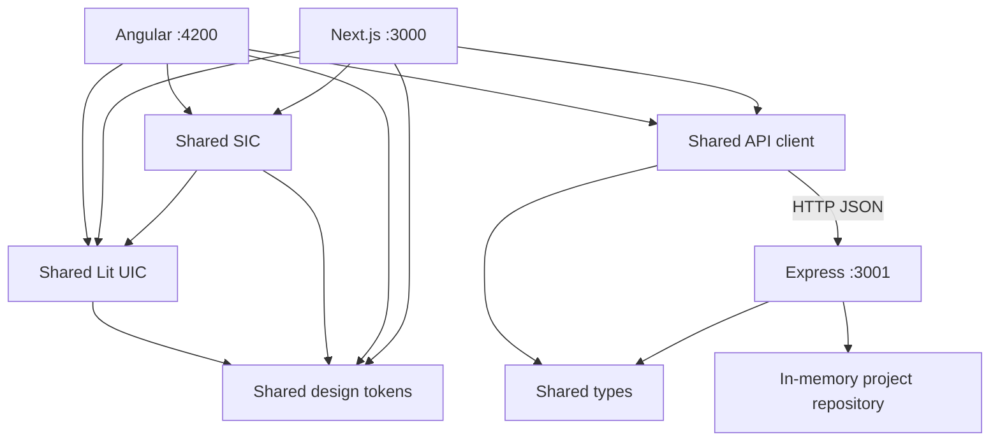

# Architecture Context

Status: proposed baseline; actual tool versions and generated project paths must be verified during setup.

## Stack
| Layer | Technology | Role |
|---|---|---|
| Workspace | Nx + npm | Project graph, tasks, caching, independent builds |
| Frontend 1 | Modern Angular + TypeScript | Standalone components and routing |
| Frontend 2 | Next.js + React + TypeScript | App Router; browser integration for Lit |
| Backend | Express + TypeScript | Single REST API |
| UI | Lit | Framework-neutral UIC and SIC Web Components |
| Styling | CSS custom properties | Shared tokens and global styles |
| Storage | In-memory repository | Local practice data; resets on server restart |
| Auth | None initially | Local single-user demonstration only |

Use mutually compatible installed versions. Inspect Nx and generator help before generating apps; do not guess CLI flags. Prefer supported Node LTS, commit the lockfile only with developer permission, and record versions in the tracker.

## System boundaries (target paths)
- `apps/angular-app/`: Angular page, routing, client state and browser registration.
- `apps/next-app/`: Next.js page, routing, client state and browser registration.
- `apps/express-api/`: REST endpoints, validation, project service and repository.
- `libs/design-tokens/src/`: `tokens.css`, `global.css`; optional typography file only if needed.
- `libs/shared-ui/src/`: atomic Lit UICs, public exports and registration.
- `libs/shared-sections/src/`: composite Lit SICs, public exports and registration.
- `libs/shared-types/src/`: pure TypeScript project and API contracts; no DOM or Node-specific dependencies.
- `libs/api-client/src/`: framework-independent fetch client and response handling.

Use public library entry points and Nx workspace import aliases/packages; choose the exact import strategy after inspecting the generated workspace. Do not create duplicate libraries to accommodate frameworks.

## System design

Arrows to libraries indicate code dependencies; only the HTTP arrow is a network call. Express does not import styles or browser components.

## Integration rules
- Angular: use `CUSTOM_ELEMENTS_SCHEMA` only at the relevant component boundaries; bind object properties and handle typed DOM custom events. Register Lit in the browser.
- Next.js: keep interactive editor in a client boundary; register custom elements client-side before mounting property-dependent components. Use typed React wrappers or JSX declarations and explicit property/event bridging as needed for installed React. Never assume that `use client` alone prevents server evaluation. No server-side rendering of Lit internals in this phase.
- Shared CSS is loaded once at each frontend root. CSS variables inherit into Lit shadow roots; ordinary global selectors do not style shadow internals.
- Configure API base URL per app, default local `http://localhost:3001`. Restrict development CORS to the two local frontend origins; CORS is not authentication.

## Proposed REST contract (approve before API work)
Project: `{ id: string; name: string }`. IDs generated by server, stable after rename. Trim names; require 1–100 characters. Names need not be unique. Return JSON except for 204. Error shape: `{ error: { code: string; message: string } }`.
| Method | Route | Input | Success |
|---|---|---|---|
| GET | /api/health | none | 200 `{ status: 'ok' }` |
| GET | /api/projects | none | 200 project array |
| GET | /api/projects/:id | none | 200 project |
| POST | /api/projects | `{ name }` | 201 project |
| PATCH | /api/projects/:id | `{ name }` | 200 project |
| DELETE | /api/projects/:id | none | 204 |
Invalid input: 400; missing project: 404; unexpected errors: 500 with safe message. Unknown body fields rejected for mutations. Initial repository seed: Ghost AI Core, Design System, My Project. No per-user data. Changes persist only during server uptime. Frontend reload/refetch, not realtime sync.

## Invariants
1. UICs are Lit; SICs compose UICs. No framework-specific duplicate implementations.
2. UIC/SIC receive data via properties/slots and emit events; no fetching, routing or app business logic.
3. Apps may import libraries; libraries never import apps. UIC never imports SIC; UI never imports API client. Shared types remain pure.
4. Express owns server data and validation. Frontends never maintain separate authoritative project stores.
5. Tokens live in one CSS source; no local copies. Enforce library boundaries with Nx tooling where applicable, plus review.
6. Local-only unauthenticated API; do not expose to public networks. No paid services or external infrastructure in initial scope.
